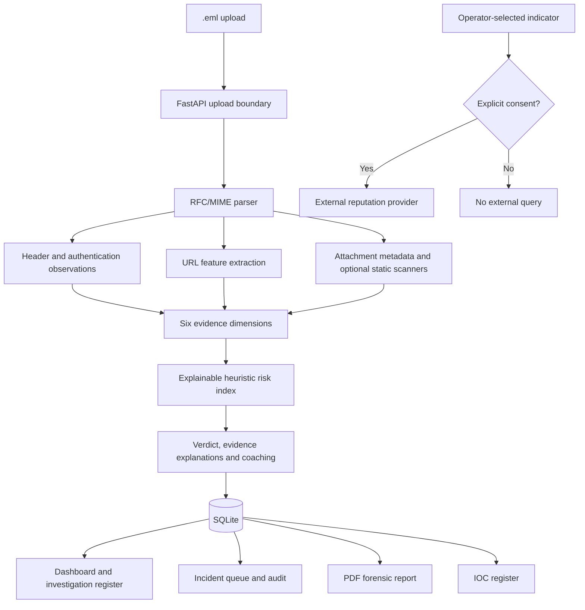

# PhishGuard 2.0 Architecture

## Product workflow

1. **Upload:** The analyst submits an `.eml` file. The API enforces an upload size limit and parses the message as untrusted input.
2. **Forensics:** The parser extracts headers, MIME structure, body text, URLs and attachment metadata.
3. **Evidence:** Header/authentication observations, URL indicators and attachment findings feed six transparent risk dimensions.
4. **Triage:** The application calculates an explainable heuristic risk index, verdict, severity, evidence list and coaching guidance. The index is not a probability.
5. **Investigation:** The analyst reviews the record, opens an incident case, assigns an analyst and updates case notes/status.
6. **Reporting:** The analyst can download a PDF forensic report and review extracted indicators.
7. **External reputation:** A domain or URL is only sent to an external provider after the analyst explicitly consents.

## Data boundaries and safety

- Email HTML is analyzed as content; it is not rendered as active content.
- URLs are parsed as strings. Normal analysis does not perform DNS lookups, open URLs or follow redirects.
- Attachments are hashed and inspected by metadata/signature. Optional YARA, ClamAV and QR scanning are static checks; attachments are never executed.
- Uploaded SPF/DKIM/DMARC results are receiver-stamped observations, not independent cryptographic verification.
- SQLite uses parameterized operations. The default application is intended for local academic demonstrations, not public deployment.
- External reputation lookups send only the chosen indicator, not the uploaded email or attachment contents. A provider no-hit is not proof of safety.

## Main API

| Method | Route | Function |
|---|---|---|
| GET | `/` | Service identity |
| GET | `/api/health` | Health and API-key mode |
| POST | `/api/analyze` | Analyze an `.eml` file |
| GET | `/api/analyses` | List stored analyses |
| GET | `/api/analyses/{id}` | Retrieve evidence record |
| GET | `/api/analyses/{id}/report.pdf` | Generate PDF report |
| GET | `/api/dashboard` | Dashboard statistics |
| GET/POST/PATCH | `/api/incidents` and `/api/incidents/{id}` | Incident workflow |
| GET | `/api/iocs` | Extracted indicator register |
| POST | `/api/threat-intel/virustotal-domain` | Explicit-consent domain lookup |
| POST | `/api/threat-intel/urlhaus` | Explicit-consent URL lookup |
| GET/POST | `/api/awareness/*` | Employee feedback and summary |
| GET | `/api/audit` | Admin audit log |

## Risk score semantics

Default dimension weights are authentication .15, headers .15, URLs .25, attachments .20, language .10 and behaviour .15. These are expert-authored starting weights, not calibrated probabilities. They require evaluation on representative labelled data before being described as optimized.
